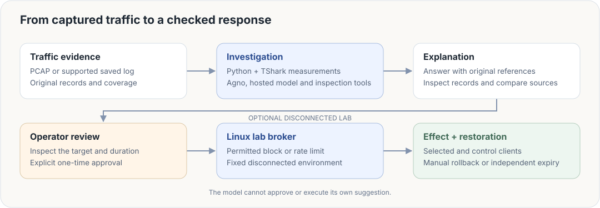

# ✳ PacketPilot

**Investigate the traffic. Check the evidence. Verify the response.**

PacketPilot gives Linux administrators one workspace for understanding a service problem, following an explanation back to its original records and checking whether an approved network change helped. It combines Python and TShark evidence processing, an Agno-powered hosted investigation and a React interface.

**[Run locally](SETUP.md)** · [Architecture](docs/HANDOFF_MAP.md) · [Results](docs/VALIDATION.md) · [Team](TEAM_ROLES.md)

## In 15 seconds

https://github.com/user-attachments/assets/f2e141b5-e950-4d24-8069-41e2da78a21f

A short product showcase using the interface components and retained lab evidence.

## One connected investigation

1. **Bring in the evidence.** Import a packet capture or supported saved traffic log. Original files, record identities and coverage stay available.
2. **Ask a practical question.** For example, “Why are replies slower than the baseline?” The model can inspect packets, flows and service statistics before answering.
3. **Check the explanation.** Open a cited record, follow the request and reply directions, or compare baseline, problem and follow-up sources.
4. **Review a response.** In the disconnected lab, inspect a temporary block or rate limit, its target and its reversal before giving separate approval.
5. **Measure and restore.** Check the selected client and the unaffected control, then roll back or let the independent expiry restore access. Export the investigation when finished.

## How it fits together



The model investigates and recommends. The operator approves, and a separate Linux service enforces the permitted action. Imported traffic alone never grants permission to change a network.

## Run locally

Ubuntu 24.04 with Python 3.12 and TShark is the reference environment. The React interface is included ready to serve. Node and Vite are not needed to use it.

```sh
git clone https://github.com/shayanxcyber/network-monitoring-llm.git
cd network-monitoring-llm
sudo apt install python3-venv tshark
python3 -m venv .venv
.venv/bin/python -m pip install -r requirements-ubuntu-verified.txt
.venv/bin/python launch.py
```

Open **http://127.0.0.1:8765**. Browsing evidence works without an API key. For hosted questions, run `.venv/bin/python configure_key.py` and enter your own key locally. The default is `deepseek-flash`, thinking enabled and max reasoning.

[SETUP.md](SETUP.md) covers file-only operation, the exact supported log format and the optional disconnected lab. Live responses require that lab installation and a fresh lab-issued capture.

## Recorded results

| Check | Result |
|---|---|
| Controlled identification | 17 of 20 scenarios passed all three repeats |
| Unwarranted benign alerts | 0 of 10 benign scenarios across 30 attempts |
| Software regression | 488 backend checks and 64 frontend checks |
| Constrained VM workflow | 2 vCPUs and 3.95 GB RAM |

The model evaluation used 60 attempts and still contained one material answer error and 12 minor citation or precision issues. These controlled development results are not general detection accuracy. [Validation](docs/VALIDATION.md) explains the methods, release boundaries, latency and resource measurements.

## Supported scope

Current input is classic Ethernet PCAP or the documented eleven-field TShark TSV, with outer unfragmented IPv4 TCP/UDP traffic in `10.77.0.0/24`. Inputs are limited to 8 MiB and 10,000 records. Visible HTTP/DNS observations and timing pairs have explicit coverage limits. There is no decryption or universal protocol decoder.

The optional response service operates only in the fixed disconnected lab. It does not change the host-management firewall or provide arbitrary shell access. Review permission to send selected evidence to a hosted provider before using real traffic.

## Explore the project

- [Evidence fields and provenance](docs/EVIDENCE_V2.md), [saved logs](docs/SAVED_FIELD_LOGS.md) and [service comparisons](docs/INVESTIGATION_DEPTH.md).
- [Model integration](docs/LLM_INTEGRATION.md), [answer quality](docs/ANSWER_QUALITY.md) and [controlled responses](docs/LINUX_RESPONSE.md).
- [Component map](docs/HANDOFF_MAP.md), [design decisions](PROJECT_DECISIONS.md) and [test results](docs/VALIDATION.md).

Built by Team C20: **Shayan Ali, Ryea Dsouza, Mohamed Khamis, Martin Huynh, Laurence Lau and Antonio Dormido**. [Team responsibilities](TEAM_ROLES.md).
